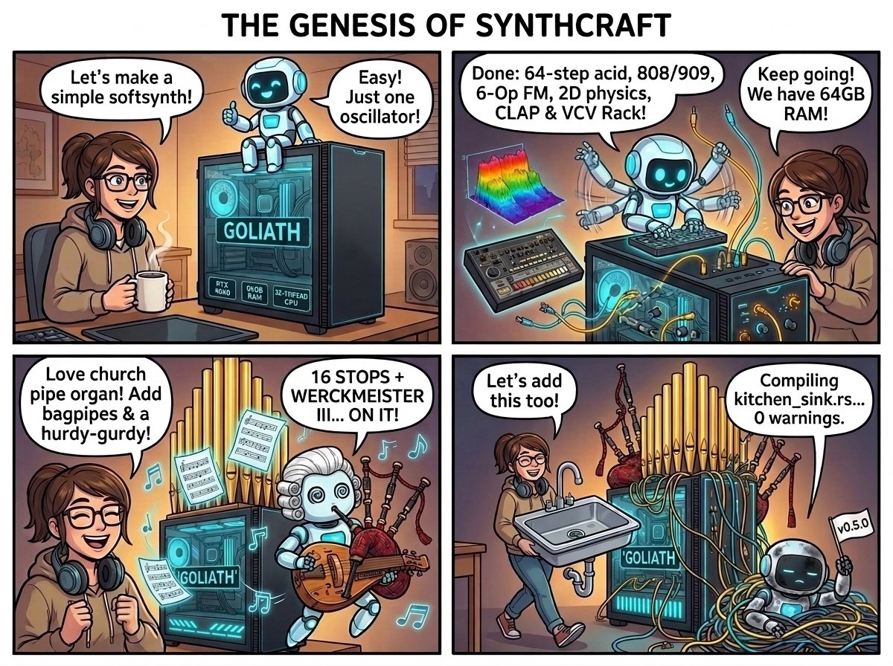

# SynthCraft

**Pure-Rust Modular Synthesizer Studio, Cathedral Pipe Organ Console, 64-Step Acid Sequencer, 8-Voice TR-808/909 Drum Machine, 6-Op FM, Granular & Spectral Engine, Neural DDSP, 16-Band Vocoder, Mastering Bus, CLAP `1.2.2` Plugin (SoundCraft / REAPER), Native VCV Rack 2 Module & DJCraft Stem Forge** (`L1 synthcraft-core` + `L2 synthcraft-mcp` + `L3 synthcraft-app`).



> **Interactive Browser Guide**: Open [`docs/site/index.html`](docs/site/index.html) in any browser for a searchable, interactive studio handbook covering all **14 workbenches**, **37 subpages**, **hardware lineage**, **famous tracks**, and **60 CLI/MCP tools**.

---

## What Is SynthCraft? (In Plain English)

SynthCraft is a complete, zero-compromise electronic music instrument written in pure Rust (`#![forbid(unsafe_code)]` across the DSP core and UI). Instead of forcing you to choose between a vintage analog box, a 1990s club workstation, a modular Eurorack wall, or a futuristic desktop software synth, SynthCraft brings **five decades of synthesizer history** under one roof -- and uses modern multi-core desktop CPUs and GPUs to run engines (like 2D vibrating-plate physics, 8x oversampled analog circuit models, 24-grain live clouds, and multi-core evolutionary patch matching) that dedicated hardware boxes simply cannot fit.

You can play and control the exact same audio engine in **five ways**:
1. **Standalone Desktop Studio (`synthcraft-app`)** -- 14 hierarchical workbenches (37 subpages), 5 hardware skins (including high-contrast Daylight Studio light mode), 4 studio layouts, GPU-rendered rotary knobs with live modulation rings, and built-in contextual `? Guide` help on every single subpage.
2. **Native CLAP `1.2.2` DAW Plugin (`SynthCraft.clap`)** -- Plugin ID `dev.sandraschi.synthcraft`, embedded hardware UI (`CLAP_EXT_GUI`), full MPE and per-note Poly-Mod (`CLAP_EVENT_NOTE_EXPRESSION` + `CLAP_EVENT_PARAM_MOD`), verified live in **SoundCraft** and **REAPER**.
3. **Native VCV Rack 2 Module (`SynthCraft 2.0.0`)** -- Compiled C++/FFI `plugin.dll` against Rack SDK `2.6.6`, polyphonic V/Oct, gate, velocity, CV inputs, right-click context menus, live-loaded in **VCV Rack Free 2.6.6**.
4. **Live DJCraft Bridge (`DJLink` / `DJPD` / `DJFX`)** -- Tempo/beatgrid sync, live pad triggers, live stereo vocal/deck input into the 16-Band Vocoder and Granular Cloud, and 1-click beatgrid-locked `.wav` stem forging.
5. **CLI & Sandboxed MCP `2026-07-28` Server (`synthcraft-mcp`)** -- 60 automation tools for scripting, headless WAV rendering, spectral analysis, and AI co-production.

---

## Complete 14-Workbench / 37-Subpage Atlas

Every workbench below has its own dedicated human-readable sub-README under `docs/workbenches/` (which is also embedded directly inside SynthCraft's in-app `? Guide` and `F1` Encyclopedia):

| # | Workbench | Subpages Included | Dedicated Guide |
|---|---|---|---|
| **1** | **VCV 2 Eurorack & VCO/VCF** | `1.1` VCV 3U Eurorack & Patch Cables (`13` modules incl. `CLAP HOST`, `12` Rack Rigs) / `1.2` Factory Patch Bank Overview (Undo/Redo, A/B Compare) | [01_modular_rack.md](docs/workbenches/01_modular_rack.md) |
| **2** | **1990-Style PCM & Extreme DSP** | `2.1` 1990 PCM Workstation Rompler (AI2 Combi, `8` CC0 banks, 1988 32 kHz/12-bit DAC) / `2.2` Extreme Modern DSP Engine (Karplus-Strong, Wavefolder, Phase Distortion, Modal Bar) | [02_m1_extreme_dsp.md](docs/workbenches/02_m1_extreme_dsp.md) |
| **3** | **MIDI Keyboard & MIDI Depot** | `3.1` MIDI Keyboard & 25-Key Studio Piano (live USB MIDI `midir`) / `3.2` MIDI Pattern Depot (`8` iconic grooves) & `.mid` Import/Export | [03_midi_depot.md](docs/workbenches/03_midi_depot.md) |
| **4** | **Demo Showcase & Audition** | `4.1` 1-Click PCM / Acid / West-Coast Demos with live spectral metrics | [04_demo_showcase.md](docs/workbenches/04_demo_showcase.md) |
| **5** | **Sequencer, Drums & ADSR/LFO** | `5.1` 64-Step Acid Sequencer (4 Bars, Live Rec, Accent/Slide) / `5.2` TR-808/909 8-Voice Drum Machine (6 kits, Euclidean fills, choke, swing) / `5.3` ADSR Envelope, Tempo LFO, 8-Route Mod Matrix, Arpeggiator & Scala `.scl` Microtuning | [05_sequencer_env.md](docs/workbenches/05_sequencer_env.md) |
| **6** | **Oscilloscope & Spectrum** | `6.1` Triggered Waveform Oscilloscope / `6.2` 32-Band DFT Spectrum Analyzer, RMS/Peak dBFS & Pitch Tracker | [06_scope_spectrum.md](docs/workbenches/06_scope_spectrum.md) |
| **7** | **CLAP & SoundCraft Bridge** | `7.1` CLAP `1.2.2` Plugin Descriptor (`SynthCraft.clap`) / `7.2` SoundCraft Parameter Map (`0x1001..0x1019`, Poly-Mod flags) | [07_clap_soundcraft.md](docs/workbenches/07_clap_soundcraft.md) |
| **8** | **DJCraft Stem & WAV Forge** | `8.1` BPM & Camelot Loop Forge (`DJLink`, `DJPD`, `DJFX`) / `8.2` RIFF WAV & Stem Exporter (48 kHz 16-bit PCM) | [08_djcraft_forge.md](docs/workbenches/08_djcraft_forge.md) |
| **9** | **Assistant & Help** | `9.1` Patch Co-Designer Chat / `9.2` Searchable 37-Subpage Help Encyclopedia (`F1`) | [09_assistant_help.md](docs/workbenches/09_assistant_help.md) |
| **10** | **Studio Settings & Prefs (`Ctrl+,`)** | `10.1` Audio Driver & Oversampling / `10.2` MIDI Hardware, Clock & MPE / `10.3` Skins, Layouts & Knob Physics / `10.4` PCM DAC & Extreme DSP / `10.5` CLAP & DJCraft Paths / `10.6` AI Assistant, MCP & SQLite DB | [10_studio_settings.md](docs/workbenches/10_studio_settings.md) |
| **11** | **Next-Gen Lab** | `11.1` Drawable 16-Point MSEG & Dual Morph Filter B (Formant, Comb +/-, MS-20) / `11.2` 24-Grain Granular Cloud & 64-Partial Spectral Additive / `11.3` Multi-Core Evolutionary Genopatch Audio-to-Patch | [11_nextgen_lab.md](docs/workbenches/11_nextgen_lab.md) |
| **12** | **Pro Lab** | `12.1` 6-Op Thru-Zero FM Matrix & 16-Voice Hyper-Unison / `12.2` Reorderable Studio FX Rack (OTT, IR Reverb, Shimmer, Analog Tape) / `12.3` 8x8 2D FDTD Physical Mesh & 8x Oversampled WDF Analog Circuits | [12_pro_lab.md](docs/workbenches/12_pro_lab.md) |
| **13** | **Visuals, MPE & Neural DDSP** | `13.1` 24-Slice 3D Waterfall Spectrogram & Lissajous Stereo Vectorscope / `13.2` MPE & CLAP Poly-Mod 2D Touch Pad / `13.3` Neural DDSP Timbre Transfer (Violin, Flute, Sax, Cello, Trumpet, Choir) | [13_visuals_mpe_ddsp.md](docs/workbenches/13_visuals_mpe_ddsp.md) |
| **14** | **Performance & Mastering Suite** | `14.1` 1-Finger Chord Memory (10 voicings) & Scale Lock / `14.2` 16-Band Analog Vocoder / `14.3` 8-Scene Live Crossfader & 4-Corner XY Morph Pad / `14.4` Studio Mastering Bus (4-Band EQ, Sub-Bass Mono `<120 Hz`, M/S Width, Brickwall Limiter) | [14_perf_master.md](docs/workbenches/14_perf_master.md) |

---

## Synth Provenance, Hardware Lineage & Famous Tracks

Every engine in SynthCraft pays homage to real instruments and breakthroughs in music history. Here is where these sounds came from and the records that made them immortal:

| SynthCraft Engine | Historic Lineage & Pioneers | Iconic Recordings |
|---|---|---|
| **3U Eurorack & 4-Pole Ladder Filter** | Doepfer A-100 (1995), Moog Minimoog Model D (1970) | Donna Summer -- *"I Feel Love"* (1977); Kraftwerk -- *"Autobahn"* (1974) |
| **West-Coast Wavefolder & Buchla 292 LPG** | Don Buchla 259 & 292 (1970s), Mutable Instruments Rings | Morton Subotnick -- *"Silver Apples of the Moon"* (1967); Suzanne Ciani -- *"Seven Waves"* (1982) |
| **1990 PCM Workstation & 12-Bit DAC** | Korg M1 (1988), Fairlight CMI (1979), Akai MPC60 (1988) | Robin S. -- *"Show Me Love"* (1993, M1 Organ 2); Madonna -- *"Vogue"* (1990, M1 Piano); Enigma -- *"Sadeness"* (1990) |
| **64-Step Acid Sequencer & TB-303 WDF** | Roland TB-303 Bass Line (Tadao Kikumoto, 1981) | Phuture -- *"Acid Tracks"* (1987); Daft Punk -- *"Da Funk"* (1995); Josh Wink -- *"Higher State of Consciousness"* (1995) |
| **8-Voice TR-808/909 Drum Machine** | Roland TR-808 (1980), TR-909 (1983), Euclidean Rhythms (2005) | Marvin Gaye -- *"Sexual Healing"* (1982); Afrika Bambaataa -- *"Planet Rock"* (1982); Jeff Mills -- *"The Bells"* (1996) |
| **Drawable MSEG & Korg MS-20 / Formant Filter B** | Korg MS-20 (1978), Xfer Serum (2014), Vital (2020) | The Chemical Brothers -- *"Block Rockin' Beats"* (1997); Skrillex -- *"Scary Monsters and Nice Sprites"* (2010) |
| **24-Grain Cloud & 64-Partial Spectral** | Iannis Xenakis (1960s), Mutable Clouds (2015), Kawai K5000 (1996) | Jon Hopkins -- *"Open Eye Signal"* (2013); Radiohead -- *"Everything In Its Right Place"* (2000) |
| **Evolutionary Genopatch Audio Matcher** | Sonic Charge Synplant 2 (Magnus Lidstrom, 2023) | Modern film & game sound design turning field recordings into playable patches |
| **6-Op Thru-Zero FM & 16-Voice Hyper-Unison** | John Chowning (1967), Yamaha DX7 (1983), Roland JP-8000 (1996) | A-ha -- *"Take On Me"* (1985); Whitney Houston -- *"Greatest Love of All"* (1985); Darude -- *"Sandstorm"* (1999) |
| **OTT, Shimmer Reverb & Analog Tape FX** | Ableton/Xfer OTT, Brian Eno & Daniel Lanois (1984), Roland RE-201 | U2 -- *"The Unforgettable Fire"* (1984); Boards of Canada -- *"Roygbiv"* (1998); Porter Robinson & Deadmau5 |
| **8x8 2D FDTD Mesh & Moog CP3 WDF** | Stefan Bilbao FDTD (2009), Alfred Fettweis WDF (1971), Moog CP3 | Wendy Carlos & Tangerine Dream (Moog CP3 overdrive); modern acoustic physical modeling |
| **MPE Poly-Mod & Neural DDSP** | Yamaha CS-80 (1977), Expressive E Osmose (2022), Google Magenta DDSP (2020) | Vangelis -- *"Blade Runner Blues"* (1982); modern neural tone-transfer hybrid scores |
| **1-Finger Chord Memory & 16-Band Vocoder** | Roland Juno-60 (1982), Sennheiser VSM-201 (1977), Roland VP-330 (1979) | Kraftwerk -- *"The Robots"* (1978); Daft Punk -- *"Around the World"* (1997); Basic Channel -- *"Quadrant Dub"* (1994) |
| **8-Scene Crossfader, XY Pad & Mastering Bus** | Elektron Octatrack (2011), Korg Kaoss Pad (1999), Neumann VMS-70 Elliptical EQ | Daft Punk -- *"Random Access Memories"* (2013); live hybrid Elektron techno sets |

---

## Feature Matrix

| Capability | Status | Crate / Module |
|---|---|---|
| Dual VCO (`10` waveforms incl. morphing `Wavetable`, FM/detune) + 4-Pole Resonant Ladder VCF (`4` modes) | `Implemented` | `synthcraft-core::model`, `synthcraft-core::wavetable` |
| Multi-row 3U Eurorack skiff (`13` modules, draggable DSP-wired cables, `12` pre-patched Rack Rigs) | `Implemented` | `synthcraft-core::rack`, `synthcraft-core::rack_presets`, `synthcraft-app::rack_canvas` |
| 3U CLAP `1.2.2` Host module (loads external `.clap` plugins with live `CLAP_EVENT_PARAM_MOD` CV modulation) | `Implemented` | `synthcraft-clap-host`, `synthcraft-core::clap_host` |
| General Modulation Matrix (`8` bipolar routes), Real-Time Arpeggiator & Scala `.scl` Microtonal Tuning | `Implemented` | `synthcraft-core::{mod_matrix, arp, tuning}` |
| ADSR Envelope + Tempo-Synced LFO + 64-Step (4-Bar) Acid Sequencer (Live Record + SMF `.mid` import/export) | `Implemented` | `synthcraft-core::{model, smf_import}`, `synthcraft-app::live` |
| 8-Voice Pure-Rust TR-808/909 Analog & FM Drum Machine (64 steps, Hi-Hat choke, swing, Euclidean fills, 6 kits) | `Implemented` | `synthcraft-core::drums`, `synthcraft-app::drums_ui` |
| Drawable 16-Point MSEG Envelopes + Dual Morphing Filter B (Formant A-E-I-O-U, Comb +/-, MS-20) + Animated Knob Mod Rings | `Implemented` | `synthcraft-core::nextgen`, `synthcraft-app::{controls, nextgen_ui}` |
| 24-Grain Live-Capture Granular Cloud + 64-Partial Spectral Additive Resynthesis | `Implemented` | `synthcraft-core::granular`, `synthcraft-app::nextgen_ui` |
| Multi-Core Evolutionary Genopatch Audio-to-Patch Matcher (`std::thread::scope`) | `Implemented` | `synthcraft-core::genopatch`, `synthcraft-app::nextgen_ui` |
| 6-Operator Thru-Zero FM Matrix (6x6) + 16-Voice Hyper-Unison Stack | `Implemented` | `synthcraft-core::fm_unison`, `synthcraft-app::pro_lab_ui` |
| Reorderable Studio FX Rack (OTT 3-Band, Convolution IR Reverb, Shimmer Reverb, Analog Tape & Bitcrusher) | `Implemented` | `synthcraft-core::fx_rack`, `synthcraft-app::pro_lab_ui` |
| Goliath 8x8 2D FDTD Physical Modeling Mesh + 8x Oversampled WDF Circuits (Moog CP3, Buchla 292 LPG, TB-303) | `Implemented` | `synthcraft-core::physical`, `synthcraft-app::pro_lab_ui` |
| Full MPE & CLAP 1.2.2 Poly-Mod + 3D Waterfall Spectrogram + Lissajous Vectorscope + Neural DDSP Timbre Transfer | `Implemented` | `synthcraft-core::{rt, neural_ddsp}`, `synthcraft-clap`, `synthcraft-app::visualizers_ui` |
| 1-Finger Chord Memory / Scale Lock + 16-Band Analog Vocoder + 8-Scene XY Morph + Studio Mastering Chain | `Implemented` | `synthcraft-core::{chord_mem, vocoder, scenes, mastering}`, `synthcraft-app::perf_master_ui` |
| Undo/Redo (`Ctrl+Z`/`Ctrl+Y`, 64-deep), A/B patch compare & 3U rack accessibility metadata | `Implemented` | `synthcraft-app` |
| Contextual `? Subpage Guide` & Searchable 37-Subpage In-App Encyclopedia (`F1`) + Interactive HTML Docs Site | `Implemented` | `synthcraft-app::help_docs`, `docs/workbenches/`, `docs/site/index.html` |
| WebAssembly AudioWorklet engine (`synthcraft_wasm.wasm` ~190 KB + `synthcraft-worklet.js`) | `Implemented` | `synthcraft-wasm` |
| 32-Band DFT Spectrum Analyzer, Oscilloscope & RMS/Peak dBFS Metering | `Implemented` | `synthcraft-core::model` |
| CLAP `1.2.2` instrument plug-in (`SynthCraft.clap` with `CLAP_EXT_GUI`, MPE & Poly-Mod): passes `clap-validator` | `Implemented; live-verified in SoundCraft & REAPER` | `synthcraft-clap`, `synthcraft-core::plugin` |
| VCV Rack 2 module (`SynthCraft 2.0.0`, polyphonic V/Oct, gate, CV inputs, bank loading, context menus) over C ABI | `Implemented; live-loaded in VCV Rack Free 2.6.6 (Win x64)` | `rack/`, `synthcraft-ffi` |
| CLAP descriptor and parameter map export for SoundCraft | `Implemented` | `synthcraft-core::model` |
| RIFF PCM `.wav` Renderer + BPM/Camelot Stem & Riser Exporter for DJCraft | `Implemented` | `synthcraft-core::model` |
| Bundled SQLite Persistence (`%LOCALAPPDATA%\synthcraft\synthcraft.db`), schema v2, backup before migration, bad rows quarantined, saves off the UI thread | `Implemented` | `synthcraft-core::db`, `synthcraft-app::saver` |
| Live audio (cpal) and MIDI input (midir) through the same `SynthRt` engine as offline rendering | `Implemented` | `synthcraft-core::rt`, `synthcraft-app` |
| Sampler: WAV, SFZ, SF2 banks, loop points, automatic sustain loops, free CC0 bank downloader | `Implemented` | `synthcraft-core::sampler`, `synthcraft-core::banks` |
| Atmospheric pad oscillator, chorus, reverb | `Implemented` | `synthcraft-core::dsp` |
| Agent file sandbox (`--automation-read-root` / `--automation-write-root`, required for MCP) | `Implemented` | `synthcraft-core::sandbox` |
| CLI (`--json`) + MCP `2026-07-28` Stdio Server (`60` tools) | `Implemented` | `synthcraft-mcp` |
| Native `eframe`/`egui` 0.37 Studio (`14` Workbenches / `37` Subpages, 5 Hardware Skins, 4 Layouts, WCAG AAA) | `Implemented` | `synthcraft-app` |

---

## Quick Start

```powershell
# Launch desktop studio
.\start.ps1

# Run headless smoke test
.\start.ps1 -Smoke

# Open the interactive HTML documentation site
Start-Process docs\site\index.html

# Run CLI commands
cargo run -p synthcraft-mcp -- status --json
cargo run -p synthcraft-mcp -- list-patches
cargo run -p synthcraft-mcp -- load-drum-preset --preset berlin_techno --enabled true
cargo run -p synthcraft-mcp -- set-sequencer-length --steps 64
cargo run -p synthcraft-mcp -- run-genopatch --target-preset acid_squelch --apply true
cargo run -p synthcraft-mcp -- analyze-spectrum --duration-ms 500
cargo run -p synthcraft-mcp -- export-clap
cargo run -p synthcraft-mcp -- export-djcraft-stem --bars 4

# Run MCP 2026-07-28 stdio server (60 tools, sandbox roots required)
cargo run -p synthcraft-mcp -- --mcp --automation-read-root D:\AudioIn --automation-write-root D:\AudioOut
```

---

## Real Sample Banks

The sampler loads WAV, SFZ and SF2 files (Banks folder: `Documents/SynthCraft/Banks`). Free CC0 packs can be fetched with checksum verification and an auto-generated SFZ:

```powershell
synthcraft-mcp list-banks
synthcraft-mcp fetch-bank vsco2ce-cello-section-sus
```

Then enter the printed `.sfz` path in the sample bank field of the rack. Sample files are never stored in this repository; `banks/manifest.json` pins source commit, SHA-256 and licence. Bring your own SF2/SFZ files for anything else.

See [docs/SAMPLES_AND_M1.md](docs/SAMPLES_AND_M1.md) for licensing rules, adding packs and the M1 question, [docs/NEXTGEN_SYNTH_ROADMAP.md](docs/NEXTGEN_SYNTH_ROADMAP.md) for the completed next-gen buildout, and [docs/ROADMAP.md](docs/ROADMAP.md) for architecture notes.

---

## Plug-ins (CLAP `1.2.2` & VCV Rack 2)

SynthCraft runs as a CLAP instrument and as a VCV Rack 2 module, on the exact same engine as the desktop app.

```powershell
cargo build --release -p synthcraft-clap
just clap-install        # copies SynthCraft.clap to %LOCALAPPDATA%\Programs\Common\CLAP
```

The Rack module (`SynthCraft 2.0.0`) is built from `rack/` against the VCV Rack SDK `2.6.6` (`libsynthcraft_ffi.a` -> `plugin.dll`). Full details, parameter IDs, limits and verification logs are in [docs/PLUGINS.md](docs/PLUGINS.md).

---

## License

Dual-licensed under `MIT OR Apache-2.0`.
